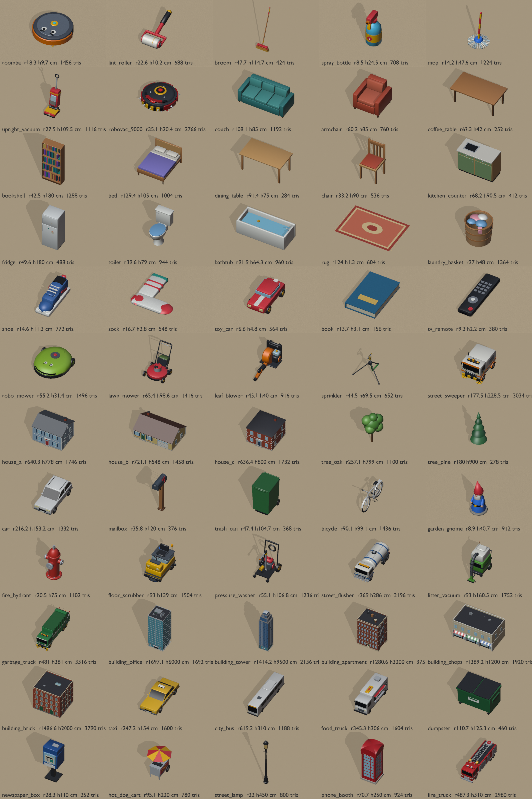
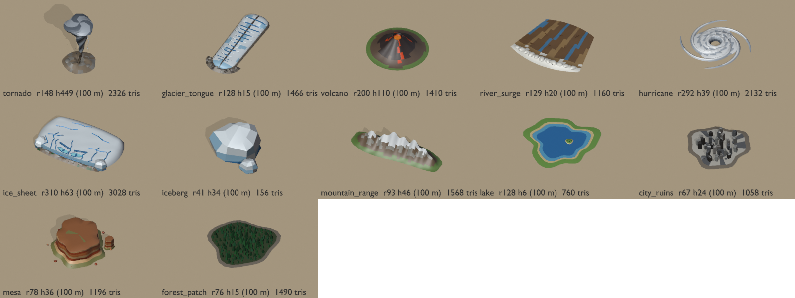
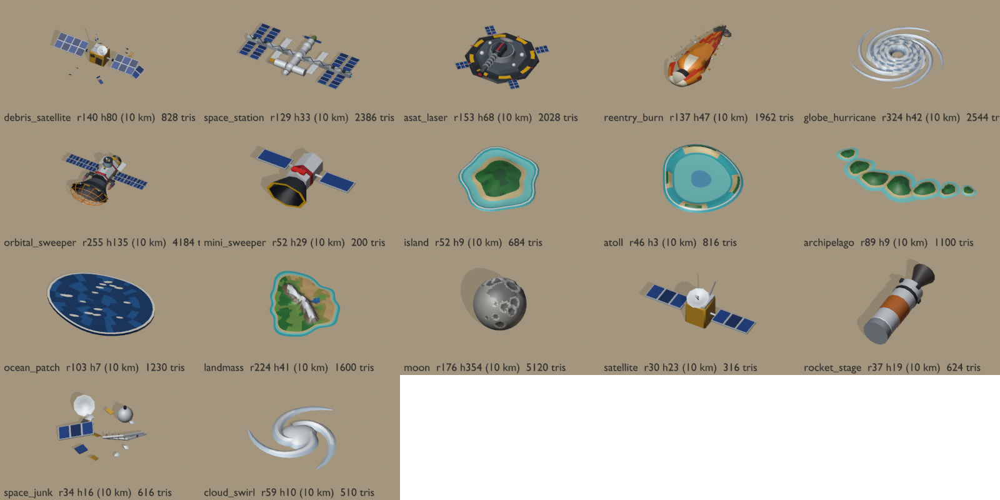
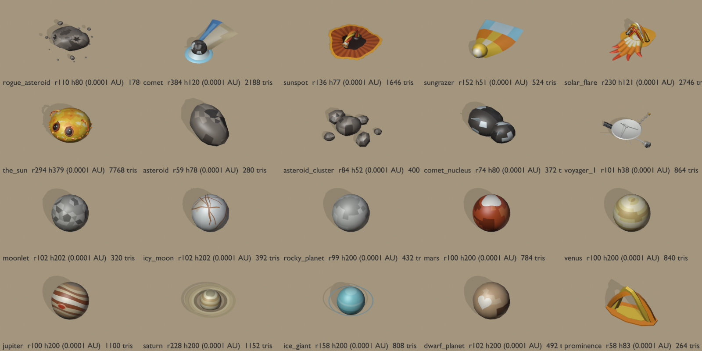
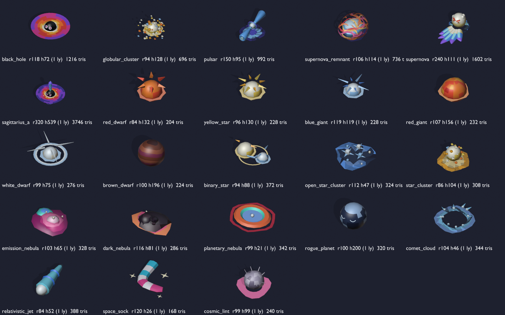
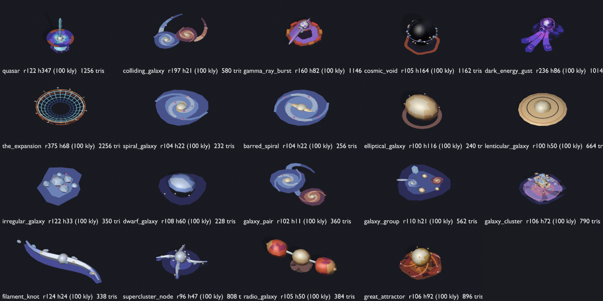

# Models

Procedural low-poly models for Dust Bunny, built with Blender (`tools/blender/`) and exported as glTF binary to `public/models/`.

## Conventions

- Units: 1 unit = 1 cm, so load at scale 1 in the cm-based world. Exception: the Continent models (`tools/blender/continent.py`, rows whose notes start with "Continent scale") use 1 unit = 100 m, because one Continent world unit is 10 km = 100 units; load them at scale 0.01 (`"scale": 0.01` in `manifest.json`). Their sizes in the table are in those 100 m units, and their catalog entries carry `"units": "100 m"`. The Globe models (`tools/blender/globe.py`, notes starting "Globe scale") use 1 unit = 10 km: see Globe scale below. The Solar System models (`tools/blender/solar.py`, notes starting "Solar scale") use 1 unit = 0.0001 AU: see Solar scale below. The Galaxy models (`tools/blender/galaxy.py`, notes starting "Galaxy scale") use 1 unit = 1 light year: see Galaxy scale below. The Universe models (`tools/blender/universe.py`, notes starting "Universe scale") use 1 unit = 100 kly: see Universe scale below.
- Axes: +Y up, forward is +Z (Blender -Y is exported as +Z).
- Origin: bottom centre at the floor contact point (y = 0). The broom is the exception: see its row.
- No Draco, no textures: Principled BSDF base colour, roughness, metallic, and emissive (roomba button, Robo-Vac eye, vacuum lamp and power light, street sweeper beacon and headlights, city vehicle beacons, headlights and signs, street lamp and tower crown lights, region vehicle beacons and light bars, the Incinerator's furnace glow, volcano lava, Ice Sheet crevasses and eyes, storm lightning).
- Each file has one root node named after the id. Static geometry is a single `body` mesh child; parts the game may animate are separate children whose origin is their pivot (listed below).
- Footprint radius is the largest horizontal distance from the origin to any vertex; height is the vertical extent.
- `public/models/catalog.json` holds the same numbers in machine-readable form (plus X/Z extents and node pivots).

## Globe scale

One Globe world unit is 1,000 km, so the Globe models (`tools/blender/globe.py`) are authored at 1 unit = 10 km (100 units per world unit) and loaded at `"scale": 0.01` in `manifest.json`, the same factor as the Continent. Their catalog entries carry `"units": "10 km"` and their table sizes are in those 10 km units: multiply by 0.01 for Globe world units (the Orbital Sweeper's 255 footprint radius is 2.55 world units). Hazards load with fit none + collapse, so the hazard code scales them by `size / modelSize`; Debris props are normalised to their Debris size by `src/entities/debrisGeometry.ts`, so only their shape and proportions matter (the Moon is drawn at its true 1,737 km radius).

## Solar scale

One Solar System world unit is 0.01 AU, so the Solar System models (`tools/blender/solar.py`) are authored at 1 unit = 0.0001 AU (about 15,000 km; 100 units per world unit) and loaded at `"scale": 0.01` like the Globe models. Their catalog entries carry `"units": "0.0001 AU"` and their table sizes are in those units: multiply by 0.01 for Solar System world units (the Sun's 292 footprint radius is 2.92 world units). Hazards load with fit none + collapse and are scaled by `size / modelSize`; Debris props are normalised to their Debris size, so they are drawn at a convenient size (planets: radius 100, resting on the floor, rings flat in XZ) and only their proportions matter. The camera looks down from the +Z side, so the Sun's eyes, Jupiter's Great Red Spot and Pluto's heart face +Z and upwards. Saturn's and the ice giant's rings count in the footprint radius, so their spheres draw at 1 / 2.28 and 1 / 1.58 of the Debris size.

## Galaxy scale

One Galaxy world unit is 100 light years, so the Galaxy models (`tools/blender/galaxy.py`) are authored at 1 unit = 1 ly (100 units per world unit) and loaded at `"scale": 0.01` like the Solar System models. Their catalog entries carry `"units": "1 ly"` and their table sizes are in light years: multiply by 0.01 for Galaxy world units (Sagittarius A*'s 320 footprint radius is 3.2 world units). Hazards load with fit none + collapse and are scaled by `size / modelSize`; Debris props are normalised to their Debris size (stars are drawn with a ball radius of about 60, planets radius 100), so only their proportions matter. Space is dark, so the look is carried by emissive materials; the black holes' and the supernova's eyes face +Z and upwards, towards the camera. Debris props are baked into one vertex-coloured mesh per type, which keeps base colours but drops per-part emission, so their base colours are bright and each Galaxy Debris type should set a `material.emissive` in the prop's main hue. The accretion discs (`disk`) are flat sheets in XZ with trailing spiral streaks, so spinning them about Y shows. The contact sheet uses a dark floor.

## Universe scale

One Universe world unit is 10 Mly, so the Universe models (`tools/blender/universe.py`) are authored at 1 unit = 100 kly (100,000 light years; 100 units per world unit) and loaded at `"scale": 0.01` like the Galaxy models one rung down. Their catalog entries carry `"units": "100 kly"` and their table sizes are in those units: multiply by 0.01 for Universe world units (the Expansion's footprint radius in the table divided by 100 is its radius in world units). Hazards load with fit none + collapse and are scaled by `size / modelSize`; Debris props are normalised to their Debris size (drawn with a footprint radius of about 100, galaxies lying flat on the floor), so only their proportions matter. Space is near black: every part of every Universe model is emissive (cosmic-web blue, CMB-orange accents), and Debris props keep per-part emission through the baked `emission` attribute, so their Debris types should set `material.glow`. The plain galaxies (`spiral_galaxy`, `barred_spiral`, `elliptical_galaxy`, `lenticular_galaxy`, `irregular_galaxy`, `dwarf_galaxy`) are pale cream and blue-white so a `tintAll` instance colour reads on them; the rest carry their own colours. The Expansion is a hollow frame (a metric lattice and a ring) that sits round the Bunny, not a solid body. The sock and the lint reuse the Galaxy's `space_sock` and `cosmic_lint`. The contact sheet uses a near-black floor.

## Rebuild

```sh
blender -b --factory-startup --python tools/blender/build_all.py
# only some models:
blender -b --factory-startup --python tools/blender/build_all.py -- roomba broom
# contact sheets -> docs/models-preview.png (cm models), docs/models-preview-continent.png, docs/models-preview-globe.png, docs/models-preview-solar.png, docs/models-preview-galaxy.png and docs/models-preview-universe.png
blender -b --factory-startup --python tools/blender/render_preview.py
# only the Continent sheet:
blender -b --factory-startup --python tools/blender/render_preview.py -- --continent
# only the Globe sheet:
blender -b --factory-startup --python tools/blender/render_preview.py -- --globe
# only the Solar System sheet:
blender -b --factory-startup --python tools/blender/render_preview.py -- --solar
# only the Galaxy sheet:
blender -b --factory-startup --python tools/blender/render_preview.py -- --galaxy
# only the Universe sheet:
blender -b --factory-startup --python tools/blender/render_preview.py -- --universe
```

## Catalogue

| id | category | file | footprint radius (cm*) | height (cm*) | size X × Z (cm*) | forward | pivot / notes | triangles | KB |
|---|---|---|---|---|---|---|---|---|---|
| `roomba` | hazard | `public/models/roomba.glb` | 18.3 | 9.7 | 34.5 × 33.9 | +Z | side_brush node spins about its local Y (up) axis. Animated nodes: `side_brush` at (7.71, 0.6, 9.19). | 1456 | 50.5 |
| `lint_roller` | hazard | `public/models/lint_roller.glb` | 22.6 | 10.2 | 13.8 × 25.7 | +Z | Roller axis along X. drum node pivots on the roller axis at y = 3 cm; spin it about local X while rolling along Z. Animated nodes: `drum` at (0.0, 3.0, 0.0). | 688 | 25.6 |
| `broom` | hazard | `public/models/broom.glb` | 47.7 | 114.7 | 36 × 45.9 | +Z | Origin is the sweep pivot at the TOP of the handle; the floor is at y = -113. The head rests on the floor 40 cm forward (+Z). Rotate about Y through the origin to sweep. | 424 | 15.7 |
| `spray_bottle` | hazard | `public/models/spray_bottle.glb` | 8.5 | 24.5 | 10.2 × 13.6 | +Z | Nozzle points +Z; spray emits from about (0, 21.8, 8.5) in model space. | 708 | 25.0 |
| `mop` | hazard | `public/models/mop.glb` | 14.2 | 47.6 | 28.2 × 28.2 | +Z | Head footprint radius ~15 cm; stub handle leans back. | 1224 | 55.2 |
| `upright_vacuum` | hazard | `public/models/upright_vacuum.glb` | 27.5 | 109.5 | 30.8 × 46 | +Z | Intake slot on the front of the base (+Z). | 1116 | 43.3 |
| `robovac_9000` | hazard | `public/models/robovac_9000.glb` | 35.1 | 20.4 | 64.6 × 69.4 | +Z | Boss. brush_l / brush_r nodes spin about local Y. Red visor eye uses an emissive material. Animated nodes: `brush_l` at (-17.09, 1.0, 15.39), `brush_r` at (17.09, 1.0, 15.39). | 2766 | 96.2 |
| `couch` | furniture | `public/models/couch.glb` | 108.1 | 85 | 200 × 90 | +Z | Skirt gap 6 cm under the frame (Bunny can slip under). | 1192 | 36.4 |
| `armchair` | furniture | `public/models/armchair.glb` | 60.2 | 85 | 90 × 85 | +Z | Skirt gap 9 cm under the frame. | 760 | 24.9 |
| `coffee_table` | furniture | `public/models/coffee_table.glb` | 62.3 | 42 | 110 × 60 | +Z | Open underneath: 38 cm clearance below the top (no shelf or apron, so a Bunny under 38 cm can roll under). | 252 | 9.2 |
| `bookshelf` | furniture | `public/models/bookshelf.glb` | 42.5 | 180 | 80 × 30 | +Z | Open front faces +Z. | 1288 | 70.1 |
| `bed` | furniture | `public/models/bed.glb` | 129.4 | 105 | 160 × 205 | +Z | Foot of the bed faces +Z; 24 cm clearance underneath. Footprint 160 x 205 including head- and footboard. | 1004 | 32.8 |
| `dining_table` | furniture | `public/models/dining_table.glb` | 91.4 | 75 | 160 × 90 | +Z | Open underneath (71 cm clearance below the top; legs 6 x 6 cm, 6 cm in from the edges). | 284 | 10.1 |
| `chair` | furniture | `public/models/chair.glb` | 33.2 | 90 | 45 × 46 | +Z | Seat faces +Z (backrest at -Z). | 536 | 18.4 |
| `kitchen_counter` | furniture | `public/models/kitchen_counter.glb` | 68.2 | 90.5 | 122 × 62 | +Z | Cabinet doors face +Z; worktop at 90 cm. | 412 | 18.8 |
| `fridge` | furniture | `public/models/fridge.glb` | 49.6 | 180 | 75 × 72.2 | +Z | Doors face +Z. | 488 | 22.3 |
| `toilet` | furniture | `public/models/toilet.glb` | 39.6 | 79 | 42 × 67.7 | +Z | Bowl faces +Z, tank at the back (-Z). | 944 | 26.9 |
| `bathtub` | furniture | `public/models/bathtub.glb` | 91.9 | 64.3 | 170 × 75 | +Z | Long axis along X; tap end at +X. Includes a rubber duck. | 960 | 34.0 |
| `rug` | furniture | `public/models/rug.glb` | 124 | 1.3 | 213 × 140 | +Z | Flat (about 1 cm). Fringe along the X ends. | 604 | 30.0 |
| `laundry_basket` | furniture | `public/models/laundry_basket.glb` | 27 | 48 | 51.2 × 51.2 | +Z | Round wicker basket with clothes piled in. | 1364 | 41.0 |
| `shoe` | prop | `public/models/shoe.glb` | 14.6 | 11.3 | 10 × 28.7 | +Z | Sneaker, toe points +Z. | 772 | 23.8 |
| `sock` | prop | `public/models/sock.glb` | 16.7 | 2.8 | 23.2 × 25.2 | +Z | Lying flat, L-shaped. | 548 | 16.6 |
| `toy_car` | prop | `public/models/toy_car.glb` | 6.6 | 4.8 | 6.4 × 12.3 | +Z | Front faces +Z. | 564 | 24.6 |
| `book` | prop | `public/models/book.glb` | 13.7 | 3.1 | 15.1 × 23 | +Z | Lying flat, spine on -X. | 156 | 7.9 |
| `tv_remote` | prop | `public/models/tv_remote.glb` | 9.3 | 2.2 | 5 × 18.2 | +Z | IR end points +Z. | 380 | 18.8 |
| `robo_mower` | hazard | `public/models/robo_mower.glb` | 55.2 | 31.4 | 91 × 106.5 | +Z | Robotic lawn mower, front +Z. blade node spins about its local Y axis (pivot under the centre). Animated nodes: `blade` at (0.0, 2.2, 0.0). | 1496 | 53.7 |
| `lawn_mower` | hazard | `public/models/lawn_mower.glb` | 65.4 | 98.6 | 78.2 × 98.9 | +Z | Unmanned red push mower; deck centred on the origin, front +Z, handle and grass bag rise towards -Z. | 1416 | 52.0 |
| `leaf_blower` | hazard | `public/models/leaf_blower.glb` | 45.1 | 40 | 41 × 87.7 | +Z | Orange backpack leaf blower set down on the ground; the blower tube runs along the floor to the nozzle at about (0, 4.5, 45) in model space, blowing +Z. | 916 | 36.9 |
| `sprinkler` | hazard | `public/models/sprinkler.glb` | 44.5 | 69.5 | 77.7 × 68 | +Z | Impact sprinkler on a tripod. head node turns about the vertical axis through the origin; nozzle points +Z with its tip at about (0, 62.9, 13.7) in model space (head at rest). Animated nodes: `head` at (0.0, 50.0, 0.0). | 652 | 30.1 |
| `street_sweeper` | hazard | `public/models/street_sweeper.glb` | 177.5 | 228.5 | 223 × 309.7 | +Z | Boss. Municipal street sweeper, front +Z. brush_l / brush_r nodes spin about local Y. Rooftop beacon and headlights use emissive materials. Animated nodes: `brush_l` at (-75.0, 5.0, 120.0), `brush_r` at (75.0, 5.0, 120.0). | 3034 | 117.9 |
| `house_a` | furniture | `public/models/house_a.glb` | 640.3 | 778 | 1000 × 800 | +Z | Two-storey gable house, ridge along X. Fills the 1000 x 800 footprint exactly; front door centred on +Z with a step. | 1746 | 98.8 |
| `house_b` | furniture | `public/models/house_b.glb` | 721.1 | 548 | 1200 × 800 | +Z | Single-storey bungalow, ridge along X. Fills the 1200 x 800 footprint exactly; garage door on the +X half of the +Z face, front door (with step) on the -X half. | 1458 | 82.1 |
| `house_c` | furniture | `public/models/house_c.glb` | 636.4 | 800 | 900 × 900 | +Z | Brick two-storey with a pyramid roof. Fills the 900 x 900 footprint exactly; front door centred on +Z under a white portico. | 1732 | 95.4 |
| `tree_oak` | furniture | `public/models/tree_oak.glb` | 257.1 | 799 | 477.2 × 494 | +Z | Collision is the trunk only (radius 25 at the base); the lumpy canopy spreads to about r = 260. | 1100 | 24.6 |
| `tree_pine` | furniture | `public/models/tree_pine.glb` | 180 | 900 | 360 × 360 | +Z | Collision is the trunk only (radius 20 at the base); stacked-cone canopy spreads to r = 180. | 278 | 10.4 |
| `car` | prop | `public/models/car.glb` | 216.2 | 153.2 | 180.6 × 403 | +Z | Compact hatchback, front +Z. car_paint (light neutral) is the largest material and is tinted per instance. | 1332 | 53.7 |
| `mailbox` | prop | `public/models/mailbox.glb` | 35.8 | 120 | 20.5 × 48.8 | +Z | Wooden post with a rounded US-style mailbox; door faces +Z, red flag on the +X side. | 376 | 17.4 |
| `trash_can` | prop | `public/models/trash_can.glb` | 47.4 | 104.7 | 60 × 75 | +Z | Green wheelie bin; lid hinges at the back (-Z) where the two wheels and the handle are. | 368 | 19.3 |
| `bicycle` | prop | `public/models/bicycle.glb` | 90.1 | 99.1 | 56 × 178.7 | +Z | Upright on its kickstand, front wheel +Z. bike_frame (light neutral) is the largest material and is tinted per instance. | 1436 | 59.2 |
| `garden_gnome` | prop | `public/models/garden_gnome.glb` | 8.9 | 40.7 | 17.7 × 17.7 | +Z | Red pointy hat, white beard, blue coat; faces +Z on a small stone base. | 912 | 35.0 |
| `fire_hydrant` | prop | `public/models/fire_hydrant.glb` | 20.5 | 75 | 39.6 × 35.4 | +Z | Red hydrant with silver caps: pumper cap faces +Z, hose caps on +/-X. | 1102 | 35.7 |
| `floor_scrubber` | hazard | `public/models/floor_scrubber.glb` | 93 | 139 | 95 × 154 | +Z | Ride-on sidewalk scrubber, front +Z. brush node (scrub disc under the front) spins about its local Y axis. Orange roof beacon and headlights are emissive. Animated nodes: `brush` at (0.0, 5.0, 38.0). | 1504 | 60.9 |
| `pressure_washer` | hazard | `public/models/pressure_washer.glb` | 55.1 | 106.8 | 69.8 × 89.3 | +Z | Wheeled gas pressure washer cart. head node turns about the vertical axis through the origin; the spray wand points +Z with its nozzle tip at about (0, 92.8, 45) in model space (head at rest). Hose runs from the pump to the swivel post. Animated nodes: `head` at (0.0, 90.0, 0.0). | 1236 | 55.1 |
| `street_flusher` | hazard | `public/models/street_flusher.glb` | 369 | 286 | 263 × 691.7 | +Z | Municipal street-flusher water truck, front +Z: white and blue tank body, cab at the front, spray bar with seven nozzles across the front bumper (bar at y = 38, z = 346; nozzles aim forward-down from z = 350). Amber light bar and headlights are emissive. | 3196 | 115.8 |
| `litter_vacuum` | hazard | `public/models/litter_vacuum.glb` | 93 | 160.5 | 87.8 × 174.6 | +Z | Electric litter-vacuum cart (Glutton style), front +Z: green and white cart with a big ribbed intake hose arcing forward and down to a nozzle on the ground; the nozzle is centred at about (0, 5, 78) in model space with its mouth lip at z = 88. | 1752 | 68.7 |
| `garbage_truck` | hazard | `public/models/garbage_truck.glb` | 481 | 381 | 273 × 924.4 | +Z | Boss. Rear-loader garbage truck, cab +Z, compactor at -Z. brush_l / brush_r nodes (gutter brushes under the front bumper corners) spin about local Y. Amber roof beacons and headlights are emissive. Animated nodes: `brush_l` at (-100.0, 5.0, 428.0), `brush_r` at (100.0, 5.0, 428.0). | 3316 | 134.6 |
| `building_office` | furniture | `public/models/building_office.glb` | 1697.1 | 6000 | 2400 × 2400 | +Z | Glass-and-steel office tower. Fills the 2400 x 2400 footprint exactly; banded teal curtain wall, recessed glass lobby behind a steel colonnade with a revolving door and canopy centred on +Z, mechanical plant on the roof. | 1692 | 86.2 |
| `building_tower` | furniture | `public/models/building_tower.glb` | 1414.2 | 9500 | 2000 × 2000 | +Z | Slim glass skyscraper. Fills the 2000 x 2000 footprint exactly; granite podium with a recessed lobby (entrance centred on +Z), vertical-pier curtain wall, three setbacks under a pyramid crown topped at 9000 cm, then an antenna with a red beacon (emissive) to 9500 cm. | 2136 | 114.9 |
| `building_apartment` | furniture | `public/models/building_apartment.glb` | 1280.6 | 3200 | 2000 × 1600 | +Z | Five-storey brick apartment block. Fills the 2000 x 1600 footprint exactly; stoop in a recessed entry centred on +Z, fire escape in a recessed bay on the +X side, wooden water tank on the roof reaching 3200 cm. | 3752 | 197.4 |
| `building_shops` | furniture | `public/models/building_shops.glb` | 1389.2 | 1200 | 2400 × 1400 | +Z | Two-storey shop row. Fills the 2400 x 1400 footprint exactly; three shopfronts on +Z recessed 120 cm under red / green / blue striped awnings that reach the edge, flat roof behind a parapet. | 1920 | 106.8 |
| `building_brick` | furniture | `public/models/building_brick.glb` | 1486.6 | 2000 | 2200 × 2000 | +Z | Old four-storey brick warehouse / loft. Fills the 2200 x 2000 footprint exactly; arched windows, two arched loading doors and a central entrance on +Z, corbelled cornice and parapet. | 3790 | 171.2 |
| `taxi` | prop | `public/models/taxi.glb` | 247.2 | 154 | 192 × 465 | +Z | Yellow sedan cab with a roof sign and checker band, front +Z. Always yellow (not tinted). | 1600 | 68.1 |
| `city_bus` | prop | `public/models/city_bus.glb` | 619.2 | 310 | 265 × 1212 | +Z | City bus, front +Z, doors on the -X side. car_paint (light neutral) is the largest material and is tinted per instance. | 1188 | 52.5 |
| `food_truck` | prop | `public/models/food_truck.glb` | 345.3 | 306 | 275.1 × 654 | +Z | Step-van food truck, front +Z. Serving hatch with a propped awning on the +X side. car_paint (light neutral) is the largest material and is tinted per instance. | 1604 | 65.0 |
| `dumpster` | prop | `public/models/dumpster.glb` | 110.7 | 125.3 | 192 × 124.5 | +Z | Green steel dumpster with two black lids; slanted front faces +Z, fork pockets on the sides. | 460 | 22.2 |
| `newspaper_box` | prop | `public/models/newspaper_box.glb` | 28.3 | 110 | 42 × 43.5 | +Z | Coin-op newspaper box on a pedestal; window and pull handle face +Z. | 252 | 17.1 |
| `hot_dog_cart` | prop | `public/models/hot_dog_cart.glb` | 95.1 | 220 | 176 × 183.2 | +Z | Stainless hot dog cart with a red and yellow umbrella; wheels at the -Z end, push handle at -Z, service side faces +Z along the long axis. | 780 | 38.4 |
| `street_lamp` | prop | `public/models/street_lamp.glb` | 22 | 450 | 42 × 44 | +Z | Cast-iron city lamp post with a lantern head; the lantern glass is emissive warm white. | 800 | 28.8 |
| `phone_booth` | prop | `public/models/phone_booth.glb` | 70.7 | 250 | 100 × 100 | +Z | Red phone booth; glazed door with handle faces +Z, lit TELEPHONE signs (emissive) on all four sides. | 924 | 50.2 |
| `fire_truck` | prop | `public/models/fire_truck.glb` | 487.3 | 310 | 271 × 931 | +Z | Red fire engine, front +Z: crew cab, silver equipment lockers, ladder along the roof, red/white light bar (emissive). | 2980 | 127.9 |
| `landfill_compactor` | hazard | `public/models/landfill_compactor.glb` | 355.3 | 375 | 340 × 635 | +Z | Landfill compactor (CAT 836 style), front +Z: yellow articulated body, cab over the hinge, four spiked steel drums, dozer blade with a trash rack at the front. beacon node (amber, half lit) spins about its local Y axis on the cab roof. mini_compactor reuses this file. Animated nodes: `beacon` at (0.0, 348.0, 10.0). | 2856 | 132.9 |
| `freight_train` | hazard | `public/models/freight_train.glb` | 1099.6 | 457 | 308 × 2180 | +Z | Diesel freight locomotive (one unit), long axis along Z, cab at +Z: navy body with a yellow nose and sill stripe, two three-axle bogies on a short section of track (rails 144 cm apart, top of rail at y = 33). Headlights are emissive. | 2620 | 120.2 |
| `snowplow` | hazard | `public/models/snowplow.glb` | 529.5 | 350 | 340.8 × 1007.2 | +Z | Municipal snowplow truck, front +Z: orange cab and dump body heaped with salt, yellow plough blade angled across the front (right end forward), salt spreader disc at the back. Amber light bar and headlights are emissive. | 2448 | 98.2 |
| `crop_duster` | hazard | `public/models/crop_duster.glb` | 562.3 | 299.4 | 1103.3 × 747 | +Z | Single-engine crop-dusting plane (Air Tractor style), nose +Z, on its taildragger gear with the thrust line level at y = 150: yellow low wing with spray booms along the trailing edge. propeller node (three blades with yellow tips) spins about its local Z axis; pivot at the spinner. Animated nodes: `propeller` at (0.0, 150.0, 345.0). | 1658 | 75.5 |
| `river_barge` | hazard | `public/models/river_barge.glb` | 706.1 | 302 | 302 × 1382 | +Z | River barge, bow +Z: long dark hull with four red covered-hopper loads, push-tug at the stern (-Z) with push knees against the barge, a white three-deck house and a tall wheelhouse. Hull bottom on the floor (no water). | 1016 | 53.7 |
| `water_bomber` | hazard | `public/models/water_bomber.glb` | 1380.5 | 700 | 2740 × 1917 | +Z | Amphibious water-bomber (Canadair CL-415 style), nose +Z, standing on its wheels: yellow upper body, red boat hull, high straight wing with two turboprops, red wingtip floats, high tailplane on the fin. | 2070 | 73.0 |
| `incinerator` | hazard | `public/models/incinerator.glb` | 1780.8 | 2600 | 1443.9 × 3450 | +Z | Boss. The Incinerator: rail-mounted waste-to-energy plant, front +Z. Grey plant hall on four rail bogies (rails at x = +/-460 along Z), boiler house and a brick and steel chimney with a soot-black rim (top centre at (0, 2600, -600)), feed conveyor rising into an intake mouth that glows orange (emissive furnace). brush_l / brush_r are the two upright intake roller drums at the front corners; they spin about local Y, pivots at their centres. Animated nodes: `brush_l` at (-560.0, 240.0, 1500.0), `brush_r` at (560.0, 240.0, 1500.0). | 3798 | 169.2 |
| `tornado` | hazard | `public/models/tornado.glb` | 148 | 449 | 287.1 × 284.4 | +Z | Continent scale: 1 unit = 100 m, load at scale 0.01. Wanderer that pulls. Twisting funnel under a wall-cloud cap (r 130); the funnel node (funnel, cap, flying debris and a lightning bolt) spins about its local Y axis through the origin (positive = counter-clockwise from above). Static debris skirt and dust puffs (r 150) in body. Animated nodes: `funnel` at (0.0, 0.0, 0.0). | 2326 | 72.2 |
| `glacier_tongue` | hazard | `public/models/glacier_tongue.glb` | 128 | 14.9 | 100.4 × 246 | +Z | Continent scale: 1 unit = 100 m, load at scale 0.01. Lane patrol: moves along its long axis (+Z). Tongue of ice about 230 long x 80 wide (246 x 100 with the terminal moraine) with curved transverse crevasses, lateral and medial moraine stripes, and a terminal moraine of rubble at the snout (+Z end). | 1466 | 56.9 |
| `volcano` | hazard | `public/models/volcano.glb` | 200 | 110 | 400 × 400 | +Z | Continent scale: 1 unit = 100 m, load at scale 0.01. Turret that fires. Cone with a breached rim, glowing lava streaks down the flanks and a lava pool in the crater: the crater node (emissive) sits at the vent, so projectiles launch from about (0, 96, 0) in model space (upwards out of the crater). Animated nodes: `crater` at (0.0, 96.0, 0.0). | 1410 | 40.8 |
| `river_surge` | hazard | `public/models/river_surge.glb` | 128.8 | 19.9 | 220 × 190 | +Z | Continent scale: 1 unit = 100 m, load at scale 0.01. Trail-layer that leaves a wet trail. Flood-surge head moving +Z: a curling brown wave front with a foam crest along the leading edge, churning muddy water with blue streaks and floating logs behind (the trail continues from the -Z end). | 1160 | 36.4 |
| `hurricane` | hazard | `public/models/hurricane.glb` | 292 | 39 | 575.1 × 575.1 | +Z | Continent scale: 1 unit = 100 m, load at scale 0.01. Cone blaster. Flat spiral cloud bands (r 300) around a clear eye (r 38, open to the ground). bands node (dense overcast, four spiral arms, lightning) spins about its local Y axis through the origin (positive = counter-clockwise from above, the way the arms trail). body is the eyewall. The wind cone blows +Z from the front of the eyewall at about (0, 20, 60) in model space. Animated nodes: `bands` at (0.0, 0.0, 0.0). | 2132 | 69.5 |
| `ice_sheet` | hazard | `public/models/ice_sheet.glb` | 309.9 | 62.7 | 599.8 × 402 | +Z | Continent scale: 1 unit = 100 m, load at scale 0.01. Boss. A slab of continental ice 600 wide pushing a bulldozed ridge of rubble at its front (+Z) cliff. Cracked blue-white surface; crevasses glow faintly (emissive); two glowing crevasse eyes with pressure-ridge brows near the front edge and a glowing crack mouth along the cliff. calving_l / calving_r are ice chunks at the front corners; their origin is their base centre on the ground, so they can tip or slide off when they calve. Animated nodes: `calving_l` at (-232.0, 0.0, 122.0), `calving_r` at (232.0, 0.0, 122.0). | 3028 | 118.1 |
| `iceberg` | prop | `public/models/iceberg.glb` | 40.9 | 33.6 | 73.3 × 59.5 | +Z | Continent scale: 1 unit = 100 m, load at scale 0.01. Chip that calves off the Ice Sheet: jagged ice block with a dirty blue base and a smaller chunk beside it. | 156 | 10.5 |
| `mountain_range` | prop | `public/models/mountain_range.glb` | 92.9 | 46.2 | 184 × 66.3 | +Z | Continent scale: 1 unit = 100 m, load at scale 0.01. Elongated ridge of peaks, long axis along X: green foothills, brown and grey rock, snow caps above about 22 units. | 1568 | 43.1 |
| `lake` | prop | `public/models/lake.glb` | 128.5 | 6.2 | 221.7 × 229.1 | +Z | Continent scale: 1 unit = 100 m, load at scale 0.01. Nearly flat lake: deep and shallow water set just below a sandy shore ring and a grass ring, with a small wooded island. | 760 | 25.0 |
| `city_ruins` | prop | `public/models/city_ruins.glb` | 67 | 23.6 | 122.2 × 124.3 | +Z | Continent scale: 1 unit = 100 m, load at scale 0.01. What is left of a city: a cracked grey pad with a cluster of tiny broken grey towers, scorched blocks and rubble piles. | 1058 | 54.6 |
| `mesa` | prop | `public/models/mesa.glb` | 77.7 | 35.6 | 130.5 × 137.7 | +Z | Continent scale: 1 unit = 100 m, load at scale 0.01. Red flat-topped plateau: banded cliff strata over a tan talus apron, scrubby flat top, a small butte beside it and fallen boulders. | 1196 | 41.8 |
| `forest_patch` | prop | `public/models/forest_patch.glb` | 75.7 | 15.1 | 131.2 × 135.8 | +Z | Continent scale: 1 unit = 100 m, load at scale 0.01. Dense clump of tiny dark-green conifer cones on a forest-floor patch. | 1490 | 80.6 |
| `debris_satellite` | hazard | `public/models/debris_satellite.glb` | 139.8 | 79.7 | 276.8 × 175.7 | +Z | Globe scale: 1 unit = 10 km, load at scale 0.01. Wanderer that pulls. Dead, tumbling satellite: gold-foil bus with a dish, a scorched flank and a red beacon; loose fragments (r 60 to 105, low) in body. panels node (both solar wings, tilted 25 deg about X, the right one snapped near the tip) spins about its local Y axis; pivot at the bus centre (0, 34, 0). Animated nodes: `panels` at (0.0, 34.0, 0.0). | 828 | 46.8 |
| `space_station` | hazard | `public/models/space_station.glb` | 129.4 | 32.7 | 256 × 137.5 | +Z | Globe scale: 1 unit = 10 km, load at scale 0.01. Lane patrol: long axis along X (the truss, 250 long), moves along Z. Pressurised white modules run along Z through the middle (a capsule docked at the +Z end), white radiators off the truss, red/green nav lights at the truss ends. arrays node: eight blue solar wings at the truss ends (52 out from the truss); pivot on the truss axis (0, 24, 0); rotate it about local X to sun-track (keep within about +/-25 deg or the wings dip into the floor). It hovers: the lowest point is the modules' underside at y = 13.5. Animated nodes: `arrays` at (0.0, 24.0, 0.0). | 2386 | 103.7 |
| `asat_laser` | hazard | `public/models/asat_laser.glb` | 152.7 | 67.9 | 236.2 × 265.1 | +Z | Globe scale: 1 unit = 10 km, load at scale 0.01. Turret that fires. Anti-satellite laser emplacement: an octagonal armoured pad with a yellow and black hazard ring, four solar petals, radar domes and red warning lights. head node (turret drum, tracking dish at the back, long finned barrel with a red emissive lens) turns about the vertical axis through the origin; pivot (0, 20, 0). The barrel points +Z; the muzzle tip is at (0, 50, 147) in model space (head at rest). Animated nodes: `head` at (0.0, 20.0, 0.0). | 2028 | 84.7 |
| `reentry_burn` | hazard | `public/models/reentry_burn.glb` | 137.3 | 46.7 | 91.5 × 243.2 | +Z | Globe scale: 1 unit = 10 km, load at scale 0.01. Trail-layer that lays a fire trail. Re-entry capsule moving +Z: a white-hot heat shield at the front, the burnt back shell visible from above, a bow-shock collar of orange plasma round the front and sides, and a plasma trail (white core, orange, red, then smoke) streaming back to -Z with embers (the trail continues from the -Z end). | 1962 | 63.4 |
| `globe_hurricane` | hazard | `public/models/globe_hurricane.glb` | 324 | 42.1 | 621.5 × 615.8 | +Z | Globe scale: 1 unit = 10 km, load at scale 0.01. Cone blaster. A hurricane seen from orbit: flat white spiral cloud bands (r 330) with blue-grey shadows round a clear eye (r 40, open to the ocean). spiral node (dense overcast, five spiral arms, outer feeder bands, lightning) spins about its local Y axis through the origin (positive = counter-clockwise from above, the way the arms trail). body is the eyewall. The wind cone blows +Z from the front of the eyewall at about (0, 22, 68) in model space. Animated nodes: `spiral` at (0.0, 0.0, 0.0). | 2544 | 86.8 |
| `orbital_sweeper` | hazard | `public/models/orbital_sweeper.glb` | 255 | 134.8 | 503.6 × 389.6 | +Z | Globe scale: 1 unit = 10 km, load at scale 0.01. Boss. The Orbital Sweeper, a net-and-laser cleanup satellite (a vacuum cleaner for space), front +Z: a long white octagonal bus with red bands, a dust-bin canister on its back, a red emissive visor eye, an amber beacon and a cyan engine glow at the back (-Z). net node: the intake funnel (flattened, 235 wide, yellow lip, glowing cyan throat) and the orange capture net domed in front of it; pivot at its attachment to the bus, (0, 58, 50). wings node: two solar wings (6 panels, 490 tip to tip) on booms; pivot on the bus axis (0, 58, -40); rotate about local X to feather (any angle) or about local Z to flap (keep within +/-10 deg or the tips reach the floor). Two laser emitters on pylons beside the bus; lens tips at (+/-80, 62, 84) in model space, firing +Z. Animated nodes: `net` at (0.0, 58.0, 50.0), `wings` at (0.0, 58.0, -40.0). | 4184 | 189.4 |
| `mini_sweeper` | hazard | `public/models/mini_sweeper.glb` | 51.9 | 28.6 | 100 × 54 | +Z | Globe scale: 1 unit = 10 km, load at scale 0.01. Kessler-swarm minion of the Orbital Sweeper, front +Z: a small white hexagonal bus with a red band, a red emissive eye, an intake funnel with a cyan throat at the front and two solar wings. Static (no animated nodes). | 200 | 17.0 |
| `island` | prop | `public/models/island.glb` | 52.2 | 9 | 88.6 × 97 | +Z | Globe scale: 1 unit = 10 km, load at scale 0.01. Tropical island: a jungle-green hill on a sand beach inside a turquoise lagoon, ringed by a reef with a white surf line. | 684 | 22.5 |
| `atoll` | prop | `public/models/atoll.glb` | 46.5 | 3.2 | 79.9 × 84.9 | +Z | Globe scale: 1 unit = 10 km, load at scale 0.01. Ring-shaped coral atoll: a reef ring with a white surf line and a broken chain of sandy, palm-green islets round a pale turquoise lagoon with a deeper centre. | 816 | 26.2 |
| `archipelago` | prop | `public/models/archipelago.glb` | 88.9 | 9 | 173.3 × 65.2 | +Z | Globe scale: 1 unit = 10 km, load at scale 0.01. A curved chain of seven small green islands on sand rims, each in its own turquoise shallows, long axis along X. | 1100 | 31.7 |
| `ocean_patch` | prop | `public/models/ocean_patch.glb` | 102.6 | 7 | 200 × 144.8 | +Z | Globe scale: 1 unit = 10 km, load at scale 0.01. A lifted lozenge of deep ocean (200 x 144): dark blue sides, a gently waved deep-blue surface with paler swells, a white surf rim and wind-streaked whitecaps. | 1230 | 38.8 |
| `landmass` | prop | `public/models/landmass.glb` | 223.8 | 41.2 | 358.8 × 377.6 | +Z | Globe scale: 1 unit = 10 km, load at scale 0.01. A continent-sized chunk of land: a pale continental shelf and sandy coast round green lowlands, savanna and a tan desert, a lake, and a mountain chain with snow caps along a diagonal spine. | 1600 | 51.4 |
| `moon` | prop | `public/models/moon.glb` | 176.5 | 353.5 | 348 × 349.4 | +Z | Globe scale: 1 unit = 10 km, load at scale 0.01. The Moon at true size (radius 1,737 km = 174 units): a grey cratered sphere resting ON the floor (origin at the bottom of the sphere), dark maria on the top face, crater bowls with pale rims. | 5120 | 106.0 |
| `satellite` | prop | `public/models/satellite.glb` | 30.4 | 23.1 | 60 × 15.8 | +Z | Globe scale: 1 unit = 10 km, load at scale 0.01. Small intact satellite: gold-foil bus with a white dish and an antenna, two blue solar wings along X. | 316 | 18.2 |
| `rocket_stage` | prop | `public/models/rocket_stage.glb` | 36.9 | 19.2 | 18.7 × 69 | +Z | Globe scale: 1 unit = 10 km, load at scale 0.01. Spent upper stage lying on its side, long axis along Z: white tank with an orange insulation band and a black ring, interstage collar at the front (+Z), engine bell at the back (-Z). | 624 | 22.6 |
| `space_junk` | prop | `public/models/space_junk.glb` | 34.2 | 16 | 60.8 × 55.7 | +Z | Globe scale: 1 unit = 10 km, load at scale 0.01. A loose cluster of orbital junk: a torn solar panel, a bent truss, a spherical tank, a broken dish and scraps of foil and hull. | 616 | 30.8 |
| `cloud_swirl` | prop | `public/models/cloud_swirl.glb` | 59 | 9.5 | 105.9 × 99.4 | +Z | Globe scale: 1 unit = 10 km, load at scale 0.01. A small weather system seen from orbit: a white cloud spiral (three trailing arms round a puffy core) with blue-grey shading. | 510 | 15.9 |
| `rogue_asteroid` | hazard | `public/models/rogue_asteroid.glb` | 109.6 | 80.4 | 179.7 × 200.5 | +Z | Solar scale: 1 unit = 0.0001 AU (about 15,000 km), load at scale 0.01. Wanderer that pulls. A lumpy, cratered rock (about 140 x 115 x 80) with four pebbles caught in its gravity at r 80 to 105; scattered gravel on the floor in body. rock node (the rock and its pebbles) spins about its local Y axis; pivot at the rock centre (0, 40, 0). Animated nodes: `rock` at (0.0, 40.0, 0.0). | 1780 | 57.5 |
| `comet` | hazard | `public/models/comet.glb` | 383.8 | 119.8 | 251.2 × 485.7 | +Z | Solar scale: 1 unit = 0.0001 AU (about 15,000 km), load at scale 0.01. Lane patrol riding an orbit. Comet moving +Z: an icy dark nucleus (radius 60, centre (0, 60, 0)) with frost patches and sunward jets, inside a glowing coma skirt (r 100); a curved cream dust tail and a straight blue ion tail stream back to -Z (to z = -375). tail node (both tails) has its pivot at the nucleus centre (0, 60, 0); scale it along Z / flutter it about Y. Nucleus radius 60 = 0.6 world units at scale 0.01. Animated nodes: `tail` at (0.0, 60.0, 0.0). | 2188 | 58.2 |
| `sunspot` | hazard | `public/models/sunspot.glb` | 135.9 | 77.4 | 248.5 × 245.1 | +Z | Solar scale: 1 unit = 0.0001 AU (about 15,000 km), load at scale 0.01. Turret that fires flare bolts. A dark umbra (r 50) in a filamentary orange penumbra (r 106) with a bright faculae rim, flat on the floor. head node: a twisted magnetic flux tube (three emissive strands) rising from the back of the umbra and arching forward to a white-hot muzzle facing +Z; it turns about Y through its pivot at the origin (0, 0, 0). Muzzle at (0, 39, 77.3) in model space. Animated nodes: `head` at (0.0, 0.0, 0.0). | 1646 | 59.5 |
| `sungrazer` | hazard | `public/models/sungrazer.glb` | 152.1 | 51 | 136 × 204.2 | +Z | Solar scale: 1 unit = 0.0001 AU (about 15,000 km), load at scale 0.01. Trail-layer that lays an icy trail. A sungrazing comet moving +Z: a small white-hot head (r 20) at (0, 22, 46) in a yellow coma collar, and a short, wide tail fanning back to -Z (white, then orange, then icy blue at the end, where the trail continues). | 524 | 16.2 |
| `solar_flare` | hazard | `public/models/solar_flare.glb` | 230.3 | 120.7 | 190.9 × 315.2 | +Z | Solar scale: 1 unit = 0.0001 AU (about 15,000 km), load at scale 0.01. Cone blaster (blow). A bright flare ribbon patch (r 90) with two dark footpoints at x = +-58, and five flame tongues licking out to +Z (to r 240): the blast faces +Z. loop node: an arcade of three twisted emissive plasma loops (the tallest 120 high) rooted at the footpoints; it pulses / spins about its local Y axis; pivot at the origin (0, 0, 0). Animated nodes: `loop` at (0.0, 0.0, 0.0). | 2746 | 88.9 |
| `the_sun` | hazard | `public/models/the_sun.glb` | 294.4 | 379.1 | 583.3 × 585.3 | +Z | Solar scale: 1 unit = 0.0001 AU (about 15,000 km), load at scale 0.01. Boss. The Sun: a granulated emissive ball (radius 270, squashed to 0.7 in Y: height 378, centre (0, 189, 0)) with a face on the +Z side: two dark sunspot eyes with white glints under heavy penumbra brows (eye centres at (-97.8, 286.3, 209.8) and (97.8, 286.3, 209.8)). corona node: a fringe of 32 flame tongues round the equator (to r 294), spins about Y; pivot at the centre (0, 189, 0). prominence_l / prominence_r: twisted plasma loops over the left (-X) / right (+X) shoulders, pivot on the surface midway between their roots; hide them when chipped. Animated nodes: `corona` at (0.0, 189.0, 0.0), `prominence_l` at (-226.44, 291.94, 0.0), `prominence_r` at (226.44, 291.94, 0.0). | 7768 | 218.1 |
| `asteroid` | prop | `public/models/asteroid.glb` | 58.6 | 77.6 | 105.6 × 99 | +Z | Solar scale: 1 unit = 0.0001 AU (about 15,000 km), load at scale 0.01. Debris prop (normalised to its Debris size, only proportions matter). A lumpy, cratered potato of grey-brown rock (about 120 x 100 x 80). | 280 | 11.5 |
| `asteroid_cluster` | prop | `public/models/asteroid_cluster.glb` | 84 | 52.2 | 142.4 × 120.9 | +Z | Solar scale: 1 unit = 0.0001 AU (about 15,000 km), load at scale 0.01. Debris prop (normalised to its Debris size, only proportions matter). A loose clump of six rocks of different sizes, the biggest in the middle. | 400 | 18.0 |
| `comet_nucleus` | prop | `public/models/comet_nucleus.glb` | 73.7 | 79.6 | 142 × 106.2 | +Z | Solar scale: 1 unit = 0.0001 AU (about 15,000 km), load at scale 0.01. Debris prop (normalised to its Debris size, only proportions matter). A two-lobed dark comet nucleus (a rubber duck like 67P) with white frost patches and two pale sunward jets. | 372 | 13.6 |
| `voyager_1` | prop | `public/models/voyager_1.glb` | 101.3 | 37.5 | 146.2 × 148.4 | +Z | Solar scale: 1 unit = 0.0001 AU (about 15,000 km), load at scale 0.01. Debris prop (normalised to its Debris size, only proportions matter). Voyager 1: a big white dish facing up on a ten-sided silver bus with a gold record, the RTG boom (three dark power cylinders) to -X, the science boom and scan platform to +X, and the long magnetometer boom trailing back to -Z. | 864 | 36.9 |
| `moonlet` | prop | `public/models/moonlet.glb` | 101.5 | 202.1 | 200.1 × 200 | +Z | Solar scale: 1 unit = 0.0001 AU (about 15,000 km), load at scale 0.01. Debris prop (normalised to its Debris size, only proportions matter). A small grey moon: a cratered sphere (radius 100) resting on the floor, darker crater floors and pale rims. | 320 | 11.4 |
| `icy_moon` | prop | `public/models/icy_moon.glb` | 102.2 | 201.7 | 192.9 × 197 | +Z | Solar scale: 1 unit = 0.0001 AU (about 15,000 km), load at scale 0.01. Debris prop (normalised to its Debris size, only proportions matter). An icy moon like Europa: a white and cream sphere (radius 100) criss-crossed by tan-brown crack lines. | 392 | 12.7 |
| `rocky_planet` | prop | `public/models/rocky_planet.glb` | 99.4 | 200 | 195.6 × 198.5 | +Z | Solar scale: 1 unit = 0.0001 AU (about 15,000 km), load at scale 0.01. Debris prop (normalised to its Debris size, only proportions matter). A generic terrestrial planet: a light grey sphere (radius 100) with paler highlands, darker plains and a few craters; light so per-instance tints recolour it (if listed in GLB_TINTED). | 432 | 12.8 |
| `mars` | prop | `public/models/mars.glb` | 99.8 | 200 | 199.5 × 199.5 | +Z | Solar scale: 1 unit = 0.0001 AU (about 15,000 km), load at scale 0.01. Debris prop (normalised to its Debris size, only proportions matter). Mars: a rust-red sphere (radius 100) with a white north polar cap on top, dark albedo markings, paler deserts and the dark gash of Valles Marineris on the camera side. | 784 | 21.3 |
| `venus` | prop | `public/models/venus.glb` | 100 | 200 | 200 × 200 | +Z | Solar scale: 1 unit = 0.0001 AU (about 15,000 km), load at scale 0.01. Debris prop (normalised to its Debris size, only proportions matter). Venus: a pale yellow sphere (radius 100) wrapped in swirling cloud bands (a sideways Y pattern). | 840 | 26.6 |
| `jupiter` | prop | `public/models/jupiter.glb` | 100 | 199.7 | 198.9 × 199.8 | +Z | Solar scale: 1 unit = 0.0001 AU (about 15,000 km), load at scale 0.01. Debris prop (normalised to its Debris size, only proportions matter). Jupiter: a banded sphere (radius 100; cream zones, rust and brown belts, greyish poles) with the Great Red Spot; the axis is tipped 42 deg back (away from the camera) so the bands run across the face the camera sees and the Red Spot sits just below its middle. | 1100 | 34.0 |
| `saturn` | prop | `public/models/saturn.glb` | 228 | 200 | 456 × 456 | +Z | Solar scale: 1 unit = 0.0001 AU (about 15,000 km), load at scale 0.01. Debris prop (normalised to its Debris size, only proportions matter). Saturn: a pale gold banded sphere (radius 100) with a flat ring system in the XZ plane round its equator (C ring 124-152, B ring 152-195, Cassini gap, A ring 203-228; a single upward-facing sheet). | 1152 | 35.5 |
| `ice_giant` | prop | `public/models/ice_giant.glb` | 158 | 200 | 316 × 316 | +Z | Solar scale: 1 unit = 0.0001 AU (about 15,000 km), load at scale 0.01. Debris prop (normalised to its Debris size, only proportions matter). An ice giant (Uranus / Neptune): a smooth cyan sphere (radius 100) with faint paler and darker bands and one thin, faint flat ring (r 150-158). | 808 | 23.3 |
| `dwarf_planet` | prop | `public/models/dwarf_planet.glb` | 101.6 | 200 | 200 × 201.6 | +Z | Solar scale: 1 unit = 0.0001 AU (about 15,000 km), load at scale 0.01. Debris prop (normalised to its Debris size, only proportions matter). Pluto: a tan sphere (radius 100) with a dark reddish-brown equatorial belt and the pale heart (Tombaugh Regio) on the camera side. | 492 | 14.3 |
| `prominence` | prop | `public/models/prominence.glb` | 57.7 | 83.4 | 114.2 × 54 | +Z | Solar scale: 1 unit = 0.0001 AU (about 15,000 km), load at scale 0.01. Debris prop (normalised to its Debris size, only proportions matter). A chip of the Sun: a twisted plasma arc (yellow and orange strands) rooted in a glowing orange patch, spanning X. | 264 | 11.1 |
| `black_hole` | hazard | `public/models/black_hole.glb` | 118 | 72 | 236 × 236 | +Z | Galaxy scale: 1 unit = 1 light year, load at scale 0.01. Wanderer with strong suction. A dark hole (radius 36, centre (0, 48, 0)) ringed by a white-hot photon ring (r 40.5), with two glowing hungry eyes on the +Z side (centres (-13.7, 66, 28) and (13.7, 66, 28)), looking up. disk node: the accretion disc, a flat, slightly bowled sheet from r 43 to 118 streaked white, gold, orange, red, magenta in three trailing spiral arms; spins about Y; pivot at the hole centre (0, 48, 0). Animated nodes: `disk` at (0.0, 48.0, 0.0). | 1216 | 43.0 |
| `globular_cluster` | hazard | `public/models/globular_cluster.glb` | 93.8 | 127.7 | 162.2 × 157.6 | +Z | Galaxy scale: 1 unit = 1 light year, load at scale 0.01. Lane patrol on an orbit. A glowing gold-white core (r 34, centre (0, 58, 0)) in a golden halo ring (r 52). swarm node: 64 star points (white, gold, orange, pale blue) packed densely round the core out to r 95, thinning outwards; spins about Y; pivot at the core centre (0, 58, 0). Animated nodes: `swarm` at (0.0, 58.0, 0.0). | 696 | 50.9 |
| `pulsar` | hazard | `public/models/pulsar.glb` | 150.5 | 94.6 | 170.4 × 300 | +Z | Galaxy scale: 1 unit = 1 light year, load at scale 0.01. Turret with a rotating beam. head node: a white-hot neutron star (radius 20, centre (0, 60, 0)) in two magnetosphere rings, with two lighthouse beams (cones widening to r 28) along +Z and -Z out to 150; it turns about Y through its pivot at the origin (0, 0, 0). Beams emit from the star surface at (0, 60, +-20); the +Z beam tip (the muzzle) is at (0, 60, 150). body: a violet pulsar-wind glow disc (r 84) on the floor. Animated nodes: `head` at (0.0, 0.0, 0.0). | 992 | 32.6 |
| `supernova_remnant` | hazard | `public/models/supernova_remnant.glb` | 106.5 | 113.9 | 171.7 × 210.6 | +Z | Galaxy scale: 1 unit = 1 light year, load at scale 0.01. Slow trail-layer. A Crab-like remnant: an oval shell of glowing filaments (radii 86 x 56 x 104 along X, Y, Z; centre (0, 58, 0)) round a blue synchrotron glow with a white pulsar at its heart, on a dim violet glow that trails off behind it (-Z). shell node: the filament web; pulses (scale); pivot at the shell centre (0, 58, 0). Animated nodes: `shell` at (0.0, 58.0, 0.0). | 736 | 29.3 |
| `supernova` | hazard | `public/models/supernova.glb` | 240 | 111.1 | 185.8 × 318.4 | +Z | Galaxy scale: 1 unit = 1 light year, load at scale 0.01. Cone blaster. A swelling, overheated star (radius 54, centre (0, 58, 0)) with strained, angry eyes on the +Z side, on a cyan shock ring (r 78.3), and five shock tongues fanning out to +Z (to r 240, +-30 degrees): the blast faces +Z. core node: the star; pulses / swells (scale); pivot at its centre (0, 58, 0). Nozzle (emit point) on its front surface at (0, 58, 54). Animated nodes: `core` at (0.0, 58.0, 0.0). | 1602 | 52.0 |
| `sagittarius_a` | hazard | `public/models/sagittarius_a.glb` | 320 | 539.4 | 640 × 640 | +Z | Galaxy scale: 1 unit = 1 light year, load at scale 0.01. Boss. Sagittarius A*: a supermassive black hole (radius 100, centre (0, 150, 0)) in a white-hot photon ring (r 109), with two glowing, slit-pupilled eyes under heavy slanted brows and a thin magenta grin on its +Z side (eye centres (-39.3, 200, 77.2) and (39.3, 200, 77.2)), looking up. disk node: the accretion disc (r 116 to 320; white, gold, orange, red, magenta, violet and indigo in four spiral arms, with hot clumps); spins about Y; pivot at the hole centre (0, 150, 0). jet_n: the north relativistic jet, straight up from the pole to y 540 (a white core in a cyan sheath with blue knots and a violet tip); pivot at the north pole (0, 250, 0); pulse it (scale Y) or hide it when chipped. jet_s: the south jet, down from the south pole into a blue lobe (r 170) on the floor under the disc; pivot at the south pole (0, 50, 0). Animated nodes: `disk` at (0.0, 150.0, 0.0), `jet_n` at (0.0, 250.0, 0.0), `jet_s` at (0.0, 50.0, 0.0). | 3746 | 112.5 |
| `red_dwarf` | prop | `public/models/red_dwarf.glb` | 84 | 132 | 168 × 146.7 | +Z | Galaxy scale: 1 unit = 1 light year, load at scale 0.01. Debris prop (normalised to its Debris size, only proportions matter). A small red star: a mottled red ball (r 60) with six stubby corona rays (to r 84) and a dim red halo. | 204 | 11.0 |
| `yellow_star` | prop | `public/models/yellow_star.glb` | 96 | 130.2 | 192 × 192 | +Z | Galaxy scale: 1 unit = 1 light year, load at scale 0.01. Debris prop (normalised to its Debris size, only proportions matter). A Sun-like star: a yellow ball (r 60) with eight corona rays, long and short in turn (to r 96), on a pale yellow halo. | 228 | 12.2 |
| `blue_giant` | prop | `public/models/blue_giant.glb` | 118.8 | 119.3 | 237.6 × 237.6 | +Z | Galaxy scale: 1 unit = 1 light year, load at scale 0.01. Debris prop (normalised to its Debris size, only proportions matter). A hot blue giant: a blue-white ball (r 54) with a long four-point diffraction sparkle (to r 120) and four short diagonal rays, on a pale blue halo. | 228 | 12.3 |
| `red_giant` | prop | `public/models/red_giant.glb` | 106.6 | 156.5 | 196.5 × 200.4 | +Z | Galaxy scale: 1 unit = 1 light year, load at scale 0.01. Debris prop (normalised to its Debris size, only proportions matter). A bloated red giant: a big, lumpy ball (r 86) mottled orange and red with convection cells, in a wavy orange halo (to r 100); no rays. | 232 | 12.3 |
| `white_dwarf` | prop | `public/models/white_dwarf.glb` | 99.2 | 74.7 | 140.8 × 140.8 | +Z | Galaxy scale: 1 unit = 1 light year, load at scale 0.01. Debris prop (normalised to its Debris size, only proportions matter). A tiny, fierce white dwarf: a white-hot ball (r 32) inside a wide, thin ring of light (r 56 to 70) and four thin spikes (to r 100). | 276 | 12.5 |
| `brown_dwarf` | prop | `public/models/brown_dwarf.glb` | 100 | 196.5 | 194 × 199.4 | +Z | Galaxy scale: 1 unit = 1 light year, load at scale 0.01. Debris prop (normalised to its Debris size, only proportions matter). A failed star: a dim, banded ball (r 100) in browns and dusky magenta, faintly warm, like a big gas giant that never lit. | 224 | 9.7 |
| `binary_star` | prop | `public/models/binary_star.glb` | 94.1 | 88.4 | 180 × 136 | +Z | Galaxy scale: 1 unit = 1 light year, load at scale 0.01. Debris prop (normalised to its Debris size, only proportions matter). Two stars in a shared orbit: a yellow star (r 40) and a blue-white companion (r 28) on a pale orbit ring (r 62 to 68), with a glowing stream of gas between them; spans X. | 372 | 19.0 |
| `open_star_cluster` | prop | `public/models/open_star_cluster.glb` | 112.5 | 47 | 216.3 × 206.6 | +Z | Galaxy scale: 1 unit = 1 light year, load at scale 0.01. Debris prop (normalised to its Debris size, only proportions matter). A loose, young cluster (Pleiades-like): seven blue-white stars of mixed sizes, the three brightest with four-point sparkles, over a faint blue reflection-nebula haze (r 100). | 324 | 16.9 |
| `star_cluster` | prop | `public/models/star_cluster.glb` | 85.6 | 103.6 | 161.5 × 160 | +Z | Galaxy scale: 1 unit = 1 light year, load at scale 0.01. Debris prop (normalised to its Debris size, only proportions matter). A dense, compact ball of stars (the snack that stuns Sagittarius A*): a bright gold-white core (r 40) studded with twenty star points (white, gold, orange, blue) out to r 66, on a golden halo (r 80). | 308 | 21.7 |
| `emission_nebula` | prop | `public/models/emission_nebula.glb` | 102.8 | 65 | 187.9 × 182.9 | +Z | Galaxy scale: 1 unit = 1 light year, load at scale 0.01. Debris prop (normalised to its Debris size, only proportions matter). A glowing hydrogen cloud: soft, lumpy layers stacked off-centre (deep magenta outside, pink, then a pale pink core), a teal oxygen lobe, and three young stars peeking out; about 200 x 170, 60 high. | 328 | 16.4 |
| `dark_nebula` | prop | `public/models/dark_nebula.glb` | 115.8 | 80.9 | 216.8 × 150.4 | +Z | Galaxy scale: 1 unit = 1 light year, load at scale 0.01. Debris prop (normalised to its Debris size, only proportions matter). A cold cloud of dust: dark, lumpy billows (about 180 x 150, 60 high) lit from behind, so a glowing orange-pink rim shows round their edges, with a horse-head knob and two faint stars. | 286 | 13.7 |
| `planetary_nebula` | prop | `public/models/planetary_nebula.glb` | 99.1 | 20.6 | 196.3 × 172 | +Z | Galaxy scale: 1 unit = 1 light year, load at scale 0.01. Debris prop (normalised to its Debris size, only proportions matter). A Ring Nebula: a flat glowing ring (r 60, teal inside, orange outside) round a pale blue disc, a faint red outer shell (r 86 to 98) and a white dwarf at the centre. | 342 | 14.0 |
| `rogue_planet` | prop | `public/models/rogue_planet.glb` | 99.7 | 200 | 192 × 197 | +Z | Galaxy scale: 1 unit = 1 light year, load at scale 0.01. Debris prop (normalised to its Debris size, only proportions matter). A lonely rogue planet (r 100): dark slate blue with frosty patches and a frozen cap, eyes shut, dozing; it has drifted between stars for a billion years. | 320 | 12.6 |
| `comet_cloud` | prop | `public/models/comet_cloud.glb` | 104.1 | 45.8 | 192 × 204.5 | +Z | Galaxy scale: 1 unit = 1 light year, load at scale 0.01. Debris prop (normalised to its Debris size, only proportions matter). A loose shell of icy comets (an Oort cloud in miniature): ten small ice chunks with short glowing tails pointing outward, round a faint icy ring (r 60 to 96). | 344 | 19.4 |
| `relativistic_jet` | prop | `public/models/relativistic_jet.glb` | 84.2 | 52 | 50 × 168.2 | +Z | Galaxy scale: 1 unit = 1 light year, load at scale 0.01. Debris prop (normalised to its Debris size, only proportions matter). Sagittarius A*'s chip: a bolt of jet plasma flying +Z, a white-hot spindle in a cyan sheath with two blue knots and a bright head; about 160 long, radius 26. | 388 | 12.9 |
| `space_sock` | prop | `public/models/space_sock.glb` | 120.1 | 26 | 171 × 163 | +Z | Galaxy scale: 1 unit = 1 light year, load at scale 0.01. Debris prop (normalised to its Debris size, only proportions matter). Mostly hydrogen, lint and a sock: a stripy magenta, white and cyan sock lying flat, adrift, with three little sparkles round it; about 180 long. | 168 | 10.8 |
| `cosmic_lint` | prop | `public/models/cosmic_lint.glb` | 99 | 98.9 | 180 × 181.7 | +Z | Galaxy scale: 1 unit = 1 light year, load at scale 0.01. Debris prop (normalised to its Debris size, only proportions matter). A clump of cosmic lint (the Bunny's own kind, gone interstellar): a fuzzy lavender-grey ball (r 56) with stray fibres, in a faint pink hydrogen haze (r 90). | 240 | 13.0 |
| `quasar` | hazard | `public/models/quasar.glb` | 122 | 347 | 244 × 244 | +Z | Universe scale: 1 unit = 100 kly (100,000 light years), load at scale 0.01. Wanderer with pull. A blazing white-blue core (radius 26, centre (0, 96, 0)) in a white ring with a four-point cyan glare. disk node: the accretion disc, a flat, slightly bowled sheet from r 34 to 122, white, cyan, blue, violet and indigo with an orange rim in three trailing spiral arms; spins about Y; pivot at the core centre (0, 96, 0). jets node: twin narrow jets on the spin axis, north up to y 348 (white core in a cyan sheath with blue knots), south down into a violet splash (r 84) on the floor; pivot at the core centre (0, 96, 0) (pulse with scale Y). Animated nodes: `disk` at (0.0, 96.0, 0.0), `jets` at (0.0, 96.0, 0.0). | 1256 | 46.2 |
| `colliding_galaxy` | hazard | `public/models/colliding_galaxy.glb` | 197.4 | 21 | 231.9 × 306.8 | +Z | Universe scale: 1 unit = 100 kly (100,000 light years), load at scale 0.01. Lane patrol. Two small spiral galaxies mid-merger, travelling +Z: galaxy_a (pale blue-white, radius 66, in front, pivot at its centre (-34.0, 14.0, 46.0)) and galaxy_b (warm peach, radius 56, behind, pivot (40.0, 18.0, -34.0)), both flat in XZ, each spinning about its own Y (they turn in opposite senses: galaxy_b's arms wind the other way). body: a pink starburst bridge between them and two tidal tails of stars streaming back to -Z (to z -190). Animated nodes: `galaxy_a` at (-34.0, 14.0, 46.0), `galaxy_b` at (40.0, 18.0, -34.0). | 580 | 39.8 |
| `gamma_ray_burst` | hazard | `public/models/gamma_ray_burst.glb` | 160 | 81.7 | 179.5 × 248.3 | +Z | Universe scale: 1 unit = 100 kly (100,000 light years), load at scale 0.01. Turret. body: the hypernova's ejecta, a dark violet glow disc (r 86) ringed by orange and red shell fragments. head node: the collapsing star (radius 24, centre (0, 58, 0), white-hot with violet infall bands) in a violet and red collapsar disc, carrying a flared nozzle and a narrow white beam in a violet sheath along +Z (a short counter-jet on -Z); it aims about Y through its pivot at the origin (0, 0, 0). Nozzle mouth at (0, 58, 39); beam tip (the muzzle) at (0, 58, 160). Animated nodes: `head` at (0.0, 0.0, 0.0). | 1146 | 45.1 |
| `cosmic_void` | hazard | `public/models/cosmic_void.glb` | 105 | 164 | 202.9 × 202.9 | +Z | Universe scale: 1 unit = 100 kly (100,000 light years), load at scale 0.01. Trail-layer (slows). A dark bubble (radius 82, centre (0, 82, 0)), near-black with a dim indigo limb and three faint web strands over the top, ringed round its silhouette by 30 tiny bright galaxies and a thin web ring. shell node: the bubble and its rim; pulse it (scale); pivot at its centre (0, 82, 0). body: a CMB-orange glow ring on the floor round its foot (r 100.04). Animated nodes: `shell` at (0.0, 82.0, 0.0). | 1162 | 49.3 |
| `dark_energy_gust` | hazard | `public/models/dark_energy_gust.glb` | 235.9 | 85.5 | 211 × 328.2 | +Z | Universe scale: 1 unit = 100 kly (100,000 light years), load at scale 0.01. Cone blaster (blow). body: a violet and indigo swirl on the floor (r 92) and three curling violet gust wisps blowing out to +Z (to r 230, +-22 degrees). core node: a swirling violet ball (radius 34, centre (0, 52, 0)) with two tilted rings and a flared nozzle facing +Z; swells (scale); pivot at its centre (0, 52, 0). Nozzle mouth (emit point) at (0, 52, 64). Animated nodes: `core` at (0.0, 52.0, 0.0). | 1014 | 37.3 |
| `the_expansion` | hazard | `public/models/the_expansion.glb` | 374.8 | 67.9 | 699 × 723.6 | +Z | Universe scale: 1 unit = 100 kly (100,000 light years), load at scale 0.01. Boss (not a body: a frame round the Bunny, hollow inside r 130). grid node: the comoving metric lattice, five glowing concentric circles (r 130 to 300) and 24 radial spokes, curving up into a shallow bowl (y 2 at r 130 to 42 at r 300), with 12 orange chevrons pointing outwards at the rim; scale it outwards (X/Z) as space stretches; pivot at the origin (0, 0, 0). ring node: a CMB-orange band (r 322) with tick marks, and ten tiny galaxies flying off it outwards (to r about 372) with streaks behind them; turns about Y; pivot at the origin. body: a faint orange rim on the floor under the ring. Animated nodes: `grid` at (0.0, 0.0, 0.0), `ring` at (0.0, 0.0, 0.0). | 2256 | 101.2 |
| `spiral_galaxy` | prop | `public/models/spiral_galaxy.glb` | 103.5 | 22 | 203 × 196 | +Z | Universe scale: 1 unit = 100 kly (100,000 light years), load at scale 0.01. Debris prop (normalised to its Debris size, only proportions matter). A face-on spiral galaxy lying flat: a cream bulge, two trailing pale blue-white arms with pink star-forming knots, on a faint blue haze disc (r 100). Pale, so a tintAll colour reads. | 232 | 15.0 |
| `barred_spiral` | prop | `public/models/barred_spiral.glb` | 103.7 | 22 | 196 × 196 | +Z | Universe scale: 1 unit = 100 kly (100,000 light years), load at scale 0.01. Debris prop (normalised to its Debris size, only proportions matter). A barred spiral lying flat: a cream bulge crossed by a golden bar (along X), with two arms sweeping from the bar's ends, on a faint haze disc (r 100). Pale, so a tintAll colour reads. | 256 | 14.6 |
| `elliptical_galaxy` | prop | `public/models/elliptical_galaxy.glb` | 100 | 116 | 200 × 200 | +Z | Universe scale: 1 unit = 100 kly (100,000 light years), load at scale 0.01. Debris prop (normalised to its Debris size, only proportions matter). A smooth, egg-shaped elliptical galaxy (100 x 76 x 58) glowing cream at the middle to amber at the edge, with a few globular-cluster points and a dim halo ring. Pale, so a tintAll colour reads. | 240 | 12.1 |
| `lenticular_galaxy` | prop | `public/models/lenticular_galaxy.glb` | 100 | 50 | 197 × 200 | +Z | Universe scale: 1 unit = 100 kly (100,000 light years), load at scale 0.01. Debris prop (normalised to its Debris size, only proportions matter). A lenticular (S0) galaxy: a smooth lens-shaped disc (r 100) with a bright round bulge, a faint outer ring and a thin dust lane, no arms. Pale, so a tintAll colour reads. | 664 | 21.3 |
| `irregular_galaxy` | prop | `public/models/irregular_galaxy.glb` | 122.4 | 33.3 | 179.5 × 225.7 | +Z | Universe scale: 1 unit = 100 kly (100,000 light years), load at scale 0.01. Debris prop (normalised to its Debris size, only proportions matter). An irregular galaxy (Magellanic-like): a lopsided clump of lumpy blue-white star clouds with hot pink star-forming knots and a ragged haze. Pale, so a tintAll colour reads. | 350 | 21.0 |
| `dwarf_galaxy` | prop | `public/models/dwarf_galaxy.glb` | 108 | 60 | 200 × 200 | +Z | Universe scale: 1 unit = 100 kly (100,000 light years), load at scale 0.01. Debris prop (normalised to its Debris size, only proportions matter). A dwarf spheroidal galaxy: a faint, loose, squashed puff (r 70) with a dozen scattered star points and a dim halo (r 100). Pale, so a tintAll colour reads. | 228 | 15.2 |
| `galaxy_pair` | prop | `public/models/galaxy_pair.glb` | 102.5 | 11.4 | 184.2 × 142 | +Z | Universe scale: 1 unit = 100 kly (100,000 light years), load at scale 0.01. Debris prop (normalised to its Debris size, only proportions matter). An interacting pair: a pale spiral (r 52) and a smaller warm companion (r 38) linked by a bridge of stars, with one tidal tail curling away. | 360 | 22.3 |
| `galaxy_group` | prop | `public/models/galaxy_group.glb` | 110 | 21 | 206 × 201 | +Z | Universe scale: 1 unit = 100 kly (100,000 light years), load at scale 0.01. Debris prop (normalised to its Debris size, only proportions matter). A loose group of seven small galaxies (three spirals, three ellipticals, one edge-on disc) on a faint web-blue haze (r 100). | 562 | 32.2 |
| `galaxy_cluster` | prop | `public/models/galaxy_cluster.glb` | 105.9 | 71.7 | 204.6 × 200 | +Z | Universe scale: 1 unit = 100 kly (100,000 light years), load at scale 0.01. Debris prop (normalised to its Debris size, only proportions matter). A rich galaxy cluster: a giant cream elliptical at the heart of a dense ball of 36 tiny galaxies (r 66), on a faint violet-pink hot-gas halo (r 100) with a thin halo ring. | 790 | 44.4 |
| `filament_knot` | prop | `public/models/filament_knot.glb` | 123.8 | 24 | 231.2 × 49.2 | +Z | Universe scale: 1 unit = 100 kly (100,000 light years), load at scale 0.01. Debris prop (normalised to its Debris size, only proportions matter). A short strand of the cosmic web: a bright pale-blue filament (thickest in the middle) curving along X on a dim glow ribbon, with a bright knot at its middle and nine tiny galaxies strung along it. | 338 | 19.7 |
| `supercluster_node` | prop | `public/models/supercluster_node.glb` | 96.1 | 46.9 | 176.7 × 172 | +Z | Universe scale: 1 unit = 100 kly (100,000 light years), load at scale 0.01. Debris prop (normalised to its Debris size, only proportions matter). A supercluster node where four filaments of the cosmic web meet: a bright white-blue knot ringed with tiny galaxies, filament stubs radiating out to r 100 with galaxies along them, on a faint glow. | 808 | 42.0 |
| `radio_galaxy` | prop | `public/models/radio_galaxy.glb` | 105 | 49.9 | 210 × 60 | +Z | Universe scale: 1 unit = 100 kly (100,000 light years), load at scale 0.01. Debris prop (normalised to its Debris size, only proportions matter). A radio galaxy: a small cream elliptical with two thin white jets along X feeding two billowing orange-red radio lobes with hot spots at their outer ends; spans X (about 200). | 384 | 20.2 |
| `great_attractor` | prop | `public/models/great_attractor.glb` | 106 | 92.3 | 202.5 × 202.6 | +Z | Universe scale: 1 unit = 100 kly (100,000 light years), load at scale 0.01. Debris prop (normalised to its Debris size, only proportions matter). The Great Attractor (a one-off): a big warm glowing knot (r 48) of white, gold and orange, swarmed by tiny galaxies and fed by five streams of galaxies spiralling in from r 100, on a warm halo. | 896 | 41.8 |

\* Continent models: units of 100 m (see Conventions). Globe models: units of 10 km (see Globe scale). Solar System models: units of 0.0001 AU (see Solar scale). Galaxy models: light years (see Galaxy scale). Universe models: units of 100 kly (see Universe scale).

Total: 158 models, 188564 triangles, 7493 KB.



Continent models (Act 5):



Globe models (Act 6):



Solar System models (Act 7):



Galaxy models (Act 8):



Universe models (Act 9):


